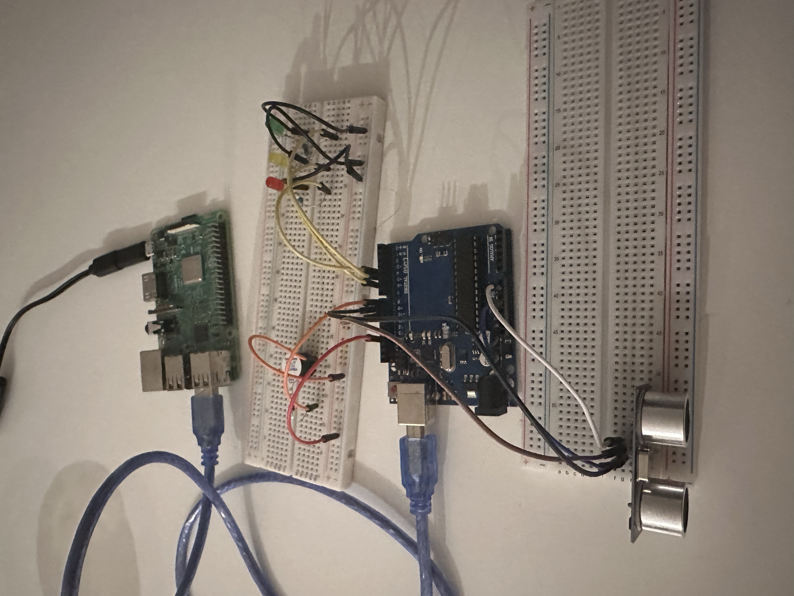

<<<<<<< used roomba model e5 

**An interactive AI robot pet built from a Roomba e5, Arduino, and Raspberry Pi.**

> **Open-source integration:** RoomPet uses [dorita980](https://github.com/koalazak/dorita980), an unofficial open-source Node.js library, to communicate with the Roomba e5 over local Wi-Fi.

### About
RoomPet responds to a person's distance and attention. An Arduino detects approach, interaction, and departure; Python manages the pet's emotional state and asks an AI to generate short dialogue; and a Wi-Fi connection sends commands to the Roomba e5. The system can run on **macOS, Windows, or Raspberry Pi OS**.

## Hardware demonstration



*Early hardware prototype. This is the electronics setup! I used whatever I had at home*

## Components used

- iRobot Roomba e5
- Roomba e5 charging dock
- Raspberry Pi 3 Model B
- Arduino Uno
- HC-SR04 ultrasonic distance sensor
- Red LED
- Yellow LED
- Green LED
- Buzzer
- Breadboards
- Jumper wires
- USB cables
- Raspberry Pi power supply

## What RoomPet does

- Detects **INTERACTING** (within 5 cm), **NEAR** (5–50 cm), and **GONE** (more than 50 cm).
- Maintains time-based emotions: **HAPPY**, **SAD**, **GRUMPY**, and **ANGRY**. The current state machine actively uses HAPPY, SAD, and ANGRY; GRUMPY is supported by the output mapping.
- Generates short, in-character dialogue through the Anthropic API.
- Changes the Arduino's LEDs and buzzer sounds to match the mood.
- Shows the latest reaction in a browser dashboard on port `8000`.
- Sends local Wi-Fi commands to the Roomba based on the mood.

| Mood | Roomba command | Arduino indication |
| --- | --- | --- |
| HAPPY | `clean` | Green LED and happy sound |
| SAD | `stop` | Yellow LED and sad sound |
| GRUMPY | `stop` | Yellow LED and grumpy sound |
| ANGRY | `dock` | Red LED and angry sound |

**Important:** `clean` starts the Roomba's built-in cleaning navigation; it is **not** a direct drive-forward command.

## System architecture

```text
Person / hand
     |
     v
HC-SR04 ultrasonic sensor
     |
     v
Arduino Uno (RoombaControl_synced.ino)
     |  USB serial: 9600 baud
     |  NEAR / INTERACTING / GONE
     v
Python controller (pet.py) ----- Anthropic API (dialogue)
     |             |
     |             +---- Web dashboard: :8000
     |             +---- Serial mood reply -> Arduino LEDs / buzzer
     v
Node.js bridge (roomba.js + dorita980)
     |  Local Wi-Fi
     v
Roomba e5 (clean / stop / dock)
```

The Arduino does not need to be wired to the Roomba's motherboard. The computer running `pet.py` connects to the Arduino by USB and to the Roomba through local Wi-Fi.

## Project files

```text
RoomPet/
├── pet.py                       # Python AI, mood state machine, dashboard
├── roomba.js                    # Node.js Roomba Wi-Fi commands
├── RoombaControl_synced.ino     # Arduino distance sensor and mood indicators
├── README.md
├── assets/
│   └── hardware-demonstration.jpg
├── package.json                 # Created during npm setup, if absent
├── package-lock.json            # Created by npm
└── .gitignore
```

> If your repository uses different filenames, rename the relevant files or adapt the commands below. Upload the Arduino sketch once using Arduino IDE; the Arduino then runs it on its own.

## Before you start (all platforms)

1. Ensure the **Roomba e5 powers on and operates normally** using its physical CLEAN button. A wheel or charging error must be resolved before autonomous movement testing.
2. Pair the Roomba with the iRobot app and connect it to your local Wi-Fi. Connect your Mac, Windows computer, or Raspberry Pi to a network that can reach the same Roomba.
3. Install [Git](https://git-scm.com/), [Python 3](https://www.python.org/downloads/), [Node.js and npm](https://nodejs.org/), and [Arduino IDE](https://www.arduino.cc/en/software) where applicable.
4. Obtain an **Anthropic API key** from the [Anthropic Console](https://platform.claude.com/).
5. Obtain your Roomba's **BLID and robot password**, and identify its **local IP address**. See [dorita980's setup instructions](https://github.com/koalazak/dorita980) for credential retrieval and device discovery. These robot credentials are different from your iRobot account login and Anthropic API key.
6. Connect the Arduino to the computer running Python with a **data-capable USB cable**. Close the Arduino IDE Serial Monitor before launching Python.
7. Make sure the sketch uses the same baud rate as Python (**9600**).

### Wiring used by the Arduino sketch

| Device | Arduino Uno pin |
| --- | --- |
| Ultrasonic TRIG | D9 |
| Ultrasonic ECHO | D10 |
| Red LED | D4 |
| Yellow LED | D5 |
| Green LED | D6 |
| Buzzer | D8 |

Connect sensor and peripheral grounds appropriately and use individual current-limiting resistors with the LEDs. Follow your sensor's and Arduino's voltage ratings; do not feed the Roomba's motor or battery power into the Arduino pins. **Check your actual wiring against the sketch before powering the circuit.**

## Setup on macOS

Open Terminal:

```bash
# Replace this placeholder with your own GitHub repository URL.
git clone YOUR_REPOSITORY_URL
cd RoomPet

python3 -m venv .venv
source .venv/bin/activate
python -m pip install requests pyserial

# If package.json is already in the repository, use npm install.
# Otherwise create it and add the required Roomba library:
npm init -y
npm install dorita980
```

If a `package.json` with the required dependency already exists, run `npm install` instead of `npm init -y`.

Find the Arduino serial port:

```bash
python pet.py --list-ports
```

A typical port is `/dev/cu.usbmodem101`, but **use the port your Mac actually reports**.

Set the required credentials in the same Terminal session (see [Credentials](#credentials)) and test:

```bash
python pet.py --port /dev/cu.usbmodem101 --no-movement
```

When sensor and AI responses work, start the complete system:

```bash
python pet.py --port /dev/cu.usbmodem101
```

## Setup on Windows

Open **PowerShell** in the project folder:

```powershell
# Replace this placeholder with your own GitHub repository URL.
git clone YOUR_REPOSITORY_URL
cd RoomPet

py -3 -m venv .venv
.\.venv\Scripts\python.exe -m pip install requests pyserial

npm init -y
npm install dorita980
```

If `package.json` already exists and declares `dorita980`, run `npm install` instead of initializing a new package. The commands below use the virtual environment's Python directly, so PowerShell activation is not required.

Find the Arduino COM port:

```powershell
.\.venv\Scripts\python.exe pet.py --list-ports
```

You can also check **Device Manager → Ports (COM & LPT)**. Replace `COM3` below with the actual port.

Set the credentials (see [Credentials](#credentials)), then start without movement:

```powershell
.\.venv\Scripts\python.exe pet.py --port COM3 --no-movement
```

Enable movement after a successful test:

```powershell
.\.venv\Scripts\python.exe pet.py --port COM3
```

## Setup on Raspberry Pi OS

This project was developed for a **Raspberry Pi 3B**. Power the Pi with a suitable **5 V / 2.5 A micro-USB supply** while testing. Keep the Roomba on its original power system.

From the Raspberry Pi terminal:

```bash
sudo apt update
sudo apt install -y git python3-venv python3-pip nodejs npm

# Replace this placeholder with your own repository URL.
git clone YOUR_REPOSITORY_URL
cd RoomPet

python3 -m venv .venv
source .venv/bin/activate
python -m pip install requests pyserial

npm init -y
npm install dorita980
```

If the repository already has a `package.json` declaring `dorita980`, run `npm install` instead of `npm init -y`.

Plug the Arduino into the Raspberry Pi's USB port and identify it:

```bash
python pet.py --list-ports
```

Typical Linux devices include `/dev/ttyACM0` and `/dev/ttyUSB0`. If access is denied, add your user to the `dialout` group and **log out and back in**:

```bash
sudo usermod -aG dialout "$USER"
```

Then set your credentials, verify Roomba connectivity, and run:

```bash
node roomba.js status
python pet.py --port /dev/ttyACM0 --no-movement
# After testing, stop with Ctrl+C, then:
python pet.py --port /dev/ttyACM0
```

For a portable build, the Raspberry Pi requires its **own suitably rated portable 5 V supply**, such as a compatible USB power bank. **Do not connect the Roomba battery directly to the Pi.** The Pi does **not** need to sit on top of the Roomba during development; it can remain on a desk and communicate over Wi-Fi. For a mobile robot, mount the Pi, Arduino, and power source securely without covering the Roomba's sensors or interfering with docking.

## Credentials

RoomPet expects these environment variables:

| Variable | Purpose |
| --- | --- |
| `ANTHROPIC_API_KEY` | AI dialogue API authentication |
| `ROOMBA_BLID` | Roomba local identifier |
| `ROOMBA_PASSWORD` | Roomba local authentication password |
| `ROOMBA_IP` | Roomba's IP address on your Wi-Fi network |
| `AI_MODEL` | Optional Anthropic model ID override |

**macOS / Raspberry Pi (Terminal):**

```bash
export ANTHROPIC_API_KEY="YOUR_ANTHROPIC_API_KEY"
export ROOMBA_BLID="YOUR_ROOMBA_BLID"
export ROOMBA_PASSWORD="YOUR_ROOMBA_PASSWORD"
export ROOMBA_IP="192.168.x.x"
```

**Windows (PowerShell):**

```powershell
$env:ANTHROPIC_API_KEY = "YOUR_ANTHROPIC_API_KEY"
$env:ROOMBA_BLID = "YOUR_ROOMBA_BLID"
$env:ROOMBA_PASSWORD = "YOUR_ROOMBA_PASSWORD"
$env:ROOMBA_IP = "192.168.x.x"
```

These are **example placeholders**, not working credentials. Do not publish keys or passwords in source files, Git commits, screenshots, or support requests. Environment variable commands can be recorded in shell history; consider a secure local secrets workflow for ongoing use.

### `.gitignore`

```gitignore
.venv/
node_modules/
.env
__pycache__/
.DS_Store
```

Commit your `package.json` and `package-lock.json` so other developers can install dependencies. Never commit secrets.

## Running RoomPet

1. Ensure the Arduino sketch is uploaded and the Arduino is connected via USB.
2. Check that the Roomba and the computer are reachable over the same local network.
3. Check Roomba status independently:

   ```bash
   node roomba.js status
   ```

4. Run `pet.py --list-ports` and select the correct serial port.
5. Test with `--no-movement` first; then remove that flag to enable commands.
6. Open `http://localhost:8000` on the machine running Python. From another device on the same network, open `http://RASPBERRY_PI_IP:8000` (replace the address appropriately).

### Manual Roomba commands

```bash
node roomba.js status
node roomba.js clean
node roomba.js stop
node roomba.js dock
```

`clean`, `stop`, and `dock` send requests through the unofficial Wi-Fi interface. A returned command response **does not guarantee that the physical action has completed**. Test in a clear area with the ability to stop the robot manually.

### Testing the AI independently

```bash
python pet.py --test-ai
```

This makes Anthropic API requests without needing the Arduino. API usage may incur charges.

## Emotion rules

The current controller exposes these timing values near the top of `pet.py`:

| Setting | Default | Meaning |
| --- | --- | --- |
| `GONE_HAPPY_GRACE_SECONDS` | 5 s | Brief happy period after leaving play |
| `NEAR_WITHOUT_PETTING_SECONDS` | 30 s | Nearby without play → SAD |
| `SAD_TO_ANGRY_SECONDS` | 30 s | Continued nearby neglect → ANGRY |
| `SUSTAINED_PETTING_SECONDS` | 10 s | Holding interaction too long → ANGRY |
| `PETTING_LIMIT` | 4 | Too many interaction entries in the time window → ANGRY |
| `PETTING_WINDOW_SECONDS` | 30 s | Rapid-interaction counting window |
| `PLAY_BREAK_SECONDS` | 4 s | Sufficient time in NEAR clears the rapid-interaction count |
| `ANGER_COOLDOWN_SECONDS` | 15 s | Time away needed to recover from anger |
| `IGNORED_SECONDS` | 180 s | Long absence starts an upset cycle |
| `ABANDONED_ANGRY_SECONDS` | 12 s | Angry portion of long-absence cycle |
| `ABANDONED_SAD_SECONDS` | 6 s | Sad portion of long-absence cycle |
| `MAX_HISTORY` | 8 events | FIFO memory discards the oldest events |

The **AI generates the dialogue, not the emotion rules**. The Arduino only reports zone transitions; Python uses those events and elapsed time to decide mood. It sends a mood back to the Arduino and a movement request to `roomba.js` when appropriate.

## Need to know: limitations

- **Distance is not touch.** The ultrasonic sensor cannot know whether someone physically petted the robot; `INTERACTING` means the measured distance is within 5 cm.
- **Zone-change sensing.** The Arduino reports stable zone transitions rather than continuous raw distance. Very fast movements may be missed.
- **Roomba e5 has no persistent Smart Map.** It does not provide reliable room-coordinate navigation through this project. `clean` uses normal Roomba navigation, not direct wheel-speed or drive-forward control.
- **Docking is not precise or guaranteed.** The e5 searches for its charging base using its built-in behavior. Start cleaning from its base when possible, keep the base accessible, and avoid moving the robot mid-mission.
- **Mood changes can interrupt docking.** The current ANGRY → SAD cycle may send `dock` and then `stop`, interrupting the return home. A dedicated docking-priority state is a recommended future improvement.
- **Unverified movement states.** A successful library response does not prove the wheels started, stopped, or docked. Errors or obstacle conditions can block motion.
- **Unofficial integration.** `dorita980` support depends on the Roomba model, firmware, and local network connectivity; firmware or Node.js changes may affect it. This project is not affiliated with iRobot.
- **Internet needed for AI dialogue.** Anthropic API calls require an internet connection, a valid API key, and API access; the emotional state machine can still run locally if dialogue is unavailable.
- **Power and mobility.** A Pi on a desk can control the Roomba over Wi-Fi, but a Pi mounted on the moving robot needs its own properly rated portable power supply. Avoid directly tapping the Roomba battery.
- **Not a safety controller.** Wi-Fi `stop` is best effort, not an emergency stop. Never test unattended near stairs, pets, cords, or fragile objects.

## Troubleshooting

| Symptom | What to check |
| --- | --- |
| `npm ERR! ENOENT ... package.json` | Run `npm init -y` first, then `npm install dorita980`, or restore the committed `package.json`. |
| `Cannot find module 'dorita980'` | Run `npm install dorita980` in the same project folder as `roomba.js`. |
| `SerialException: could not open port` | Run `python pet.py --list-ports`; use the current device name and close the Arduino Serial Monitor. |
| Linux `Permission denied` on serial | Add the user to `dialout`, log out/in, and recheck permissions. |
| No `NEAR` / `INTERACTING` / `GONE` output | Check ultrasonic wiring, USB serial connection, and that the Arduino sketch is uploaded at 9600 baud. |
| Anthropic HTTP 401 | Verify `ANTHROPIC_API_KEY` is an actual Anthropic API key and has not expired. |
| AI returns no text / max tokens | Check API/model response and output-token configuration; the program's fallback error handling prevents the sensor loop from waiting on dialogue. |
| `node roomba.js status` fails | Check BLID, robot password, Roomba IP, same-LAN access, and firmware compatibility. |
| Roomba does not move despite a command | Check for Roomba hardware faults and test the physical CLEAN button; a Wi-Fi command is not proof of motor movement. |
| Roomba wanders instead of docking | Check the Home Base power and placement; do not interrupt docking with subsequent `stop` commands. |

## Updating the Raspberry Pi from GitHub

After pushing changes from your development computer:

```bash
cd ~/RoomPet  # or the actual path where you cloned the repository
git pull --ff-only
```

Reinstall dependencies if you changed Python requirements or `package.json`. Keep local credentials outside Git and restart the Python process after changes.

---

**RoomPet** is an experimental personal robotics project combining embedded sensing, AI dialogue, and existing Roomba functionality.
>>>>>>> b30c5ac (Add README.md)
